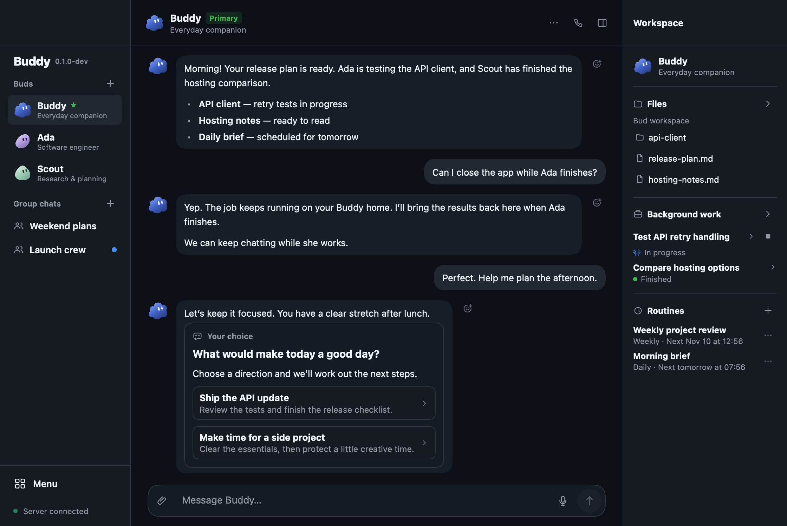
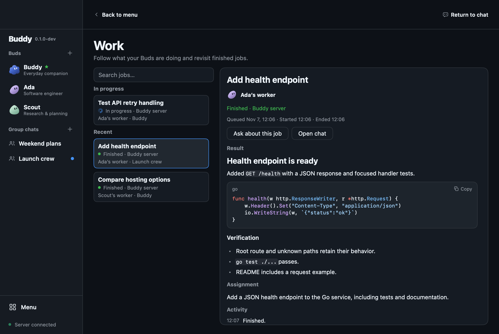
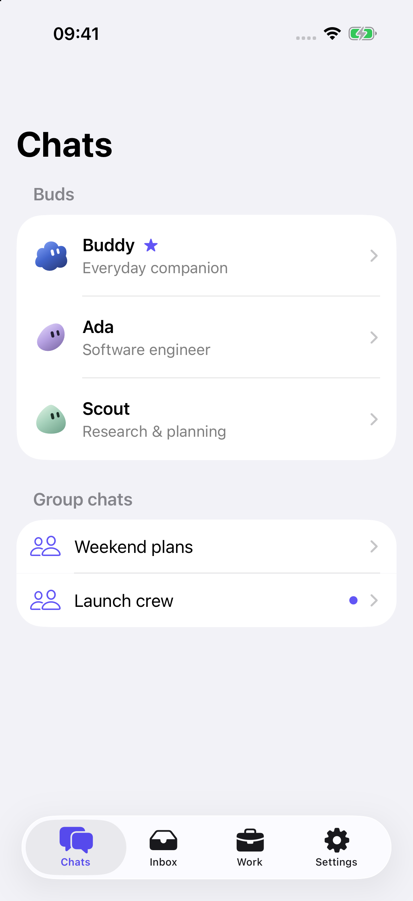
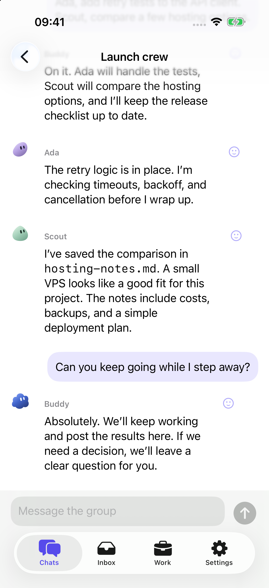
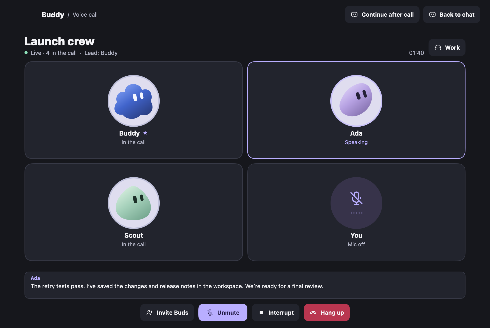
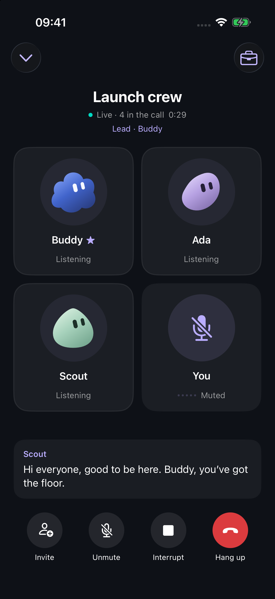

# Buddy

**Your Buds. Your projects. A conversation that keeps going.**

Buddy is a personal home for AI companions, called **Buds**. Chat through an idea,
ask for help with everyday tasks, or hand off a project and come back to the result.
Each Bud has its own role, personality, memory, and workspace.

A Go server keeps conversations and work running independently of the apps. Use
the native macOS desktop or the iPhone companion to connect to the same Buddy home.
Host that home on an always-on machine to keep jobs, routines, and watches running
around the clock.

> [!IMPORTANT]
> **Early development — expect rough edges.**
> Buddy is evolving quickly. Interfaces, APIs, and data formats may change.
> Build from source to try it today, and back up your Buddy home before updating.

**macOS desktop · iPhone companion · Go server for macOS and Linux**

[Features](#what-it-does) · [Screenshots](#screenshots) · [Voice calls](#voice-calls) · [Get started](#install-and-run) · [Full guide](docs/guide.md)

## What it does

- **Persistent companions.** Give Buds different roles, customize their appearance,
  and let them build useful memories over time.
- **Conversation and collaboration.** Talk one to one, bring Buds together in group
  chats, or invite them into a live voice call on desktop or iPhone.
- **Work that keeps going.** Hand off development or research, keep chatting, and
  get results or questions back in the conversation. Review progress in Work.
- **A workspace for each Bud.** Open files beside the chat, preview Markdown and
  code, inspect diffs, and edit text in the desktop app.
- **Routines and watches.** Schedule recurring tasks or ask Buds to watch specific
  activity in connected services.
- **Connections and tools.** Connect GitHub, Gmail, Grafana, Prometheus, and custom
  MCP servers. Add worker devices so jobs can run on other machines.
- **Reusable skills.** Use slash commands for common workflows or import a custom
  `SKILL.md`. Share files and images in desktop chat and generate images with a
  configured OpenAI API key.

Buddy is for people who want ongoing help across projects and daily life. A Bud
can help plan a day, maintain project notes, investigate a failing build, or keep
an eye on an inbox while longer work runs elsewhere.

## Screenshots

Captured from the running apps with fictional demo conversations, files, jobs,
and call participants.
The iPhone screenshots are from the iOS Simulator.

### Desktop

Chat, quick decisions, files, and background work in one place.



Inspect a job’s result, rendered code, and progress in Work.



### iPhone

Connect to the same Buddy home to chat, make decisions, and check work on the go.
Choose Light, GitHub Dark, or your system appearance in Settings.

<p>
  
  
</p>

## Voice calls

Call a Bud from a conversation on **macOS or iPhone**, then invite others to join.
Speaking Buds animate, live captions keep everyone in the loop, and naming a Bud
gives them the next turn. Discuss an idea, hand off work, or ask about a job while
it runs. You can return to chat while the call stays connected.

When a one-to-one call becomes a group, Buddy keeps its participants and transcript
together in a group chat. Ask the Buds to continue collaborating there after you
hang up.

The desktop call room with three demo Buds and the caller.



<p>
  
</p>

Live voice requires an OpenAI API key with Realtime access on the Buddy server.
See the [voice setup guide](docs/guide.md#live-voice-calls).

## Install and run

### macOS desktop

Install Git, Go **1.27.3 or later**, Xcode Command Line Tools, and the Codex CLI.
The default model is GPT-6.1 Terra, which requires Codex CLI **0.159.0 or later**.

```sh
git clone https://github.com/Hortlund/buddy.git
cd buddy
./script/build_and_run.sh
```

The script builds the desktop app and server, then opens Buddy. On first launch,
choose **Start on this Mac** or connect to an existing Buddy home. Configure the
model runtime in **Menu → Connections → Runtimes**.

For Codex CLI authentication, run `codex login` on the machine hosting the server.
An OpenAI API key can also be saved in Connections. Live voice and image generation
require API access configured for those capabilities.

The local server uses `https://127.0.0.1:7331`. Development state and logs live in
`.buddy/`, and build output goes to `dist/`. Both directories are ignored by Git.
Closing the app leaves the server running while the Mac is awake and signed in.

### Always-on server and other devices

Paste this into a terminal on a Linux server, always-on PC, or Mac:

```sh
curl -fsSL https://raw.githubusercontent.com/Hortlund/buddy/main/script/install-server.sh | bash
```

The installer builds Buddy, installs Codex and Go, creates a managed service,
and sets up private access through Tailscale. Follow the Tailscale sign-in link,
then run `buddy-server login` or add an API key from the desktop. Setup prints a
private connection file for your desktop; `buddy-server pair` shows an iPhone QR.
Install Tailscale on your client devices using the same account.

Linux starts at boot and runs under a dedicated `buddy` account. On macOS,
Buddy starts at login; keep that Mac awake and signed in. Windows hosting uses
WSL2 with systemd. Re-running the installer preserves the existing installation.
See the guide for requirements, setup options, and maintenance commands.

- [Host a Buddy server](docs/guide.md#host-buddy-on-another-machine)
- [Connect the iPhone app](docs/guide.md#buddy-for-iphone)
- [Add worker devices](docs/guide.md#run-work-on-another-device)
- [Move an existing Buddy home](docs/guide.md#move-the-home-server)

### iPhone app

Open `ios/Buddy.xcodeproj` in Xcode and select the **Buddy** scheme. Run it on an
iOS 17+ simulator or sign it with a development team for a physical iPhone.
In desktop Connections, choose **Pair iPhone**, then scan the QR code or paste
the pairing link into the iPhone app.

## Documentation

The [setup and usage guide](docs/guide.md) covers first launch, runtime credentials,
integrations, voice calls, routines, memory, custom skills, MCP servers, and
deployment. It also documents current limits and optional configuration.

## Development and contributions

Bug reports, design feedback, and focused pull requests are welcome. For a bug,
include the app version, operating system, steps to reproduce, and relevant logs
with credentials and private conversation data removed.

Run the Go checks from the repository root.

```sh
go test ./...
go vet ./...
```

With the Codex CLI signed in, `python3 script/smoke_desktop.py` exercises the native
desktop against a temporary Buddy home. The hosting smoke tests use local Docker. Run
`python3 script/smoke_install_server.py --full-build` to check a fresh server
install, downloaded toolchains, private access, pairing, and restart persistence.
Tailscale and the service manager use local fixtures; no account sign-in is needed.
See the guide for details.

The main components are `cmd/buddy` for the Go/MyGo desktop, `cmd/buddyd` for the
server, `cmd/buddyworker` for remote work, and `ios/Buddy` for the SwiftUI client.

Keep API keys, OAuth downloads, connection files, server state, and backups out of
commits. The repository’s ignore rules cover common local files and generated
output.
