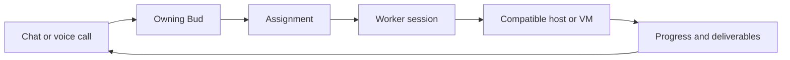

# Projects, workers, and computer use

A **Bud** is your persistent teammate. An **assignment** is a piece of work it
owns. A **worker session** carries out that assignment on a particular host.
Sessions keep their own checkout, branch, progress, and deliverables; they do not
create extra permanent Buds. Your Bud remains available in chat and calls.



Small tasks can stay in chat. Longer implementation, research, browser, or desktop
tasks can be handed off. The model chooses using the conversation, team activity,
project, and host capabilities. Buddy validates that choice before a host claims
the assignment. It does not install software or enable desktop access implicitly.

## Follow the team

Open **Menu → Work** on desktop, or **Work** on iPhone:

- **Needs you** collects questions and blocked assignments.
- **Active** shows running and queued assignments.
- **Recent** keeps finished and stopped work available.
- Filter by Bud, project, host, or search text.
- Open an assignment for its brief, activity, worker sessions, dependencies,
  result, and returned files. Ask about it in chat, or stop it.

Workers can refresh team context, inspect related work, post updates, and delegate
a bounded subtask to another Bud in the same conversation. Delegation retains the
parent assignment and project. It is limited to eight children per assignment and
four levels. Stop also stops active delegated descendants; files and history stay.
Independent assignments continue. Workers should share branches, findings, and
deliverables in their briefs rather than assuming another host sees their disk.

## Choose a host

**Connections → Hosts and capabilities** shows the server and paired worker
devices: OS, architecture, environment, installed tools, enabled automation, and
readiness. A CLI on PATH is not always ready: Docker needs a running daemon,
desktop tools need a visible session and OS grants, and Playwright needs a browser.

| Host | Useful setup |
| --- | --- |
| Headless Linux VPS | Codex, Git, language tools, isolated Playwright browser |
| macOS desktop | Coding tools plus Cua Driver in a logged-in desktop |
| Linux desktop | Coding tools plus Cua Driver on a supported display/compositor |
| Apple Silicon Mac with Lume | Lume manages VMs; pair a Buddy worker inside each guest |

Buddy's server and worker currently build on macOS and Linux. Cua Driver also
supports Windows, but Buddy's Unix-only filesystem and process management still
need a Windows port. Windows is not an end-to-end supported Buddy host yet.

Ask naturally: “Have the reviewer check this on a host with Go,” or “Use the VM
desktop to check the app.” An explicitly chosen device can wait for readiness;
automatic placement requires a ready, online host with the required project
checkout and capabilities. Generic portable jobs can use the shared worker pool.
One worker process runs one assignment at a time; the server has three background
slots. Desktop assignments serialize per host so two workers do not fight over
one desktop. Separate VM workers have separate desktops.

Pair devices using [the device setup guide](guide.md#run-work-on-another-device). Their
credentials, installed tools, checkouts, and execution configuration stay local.
Buddy sends assignment data, not executable provider configuration or server
credentials. Workers contact the server outbound through its pinned TLS connection.

Keep the execution configuration in the private credential directory (0700) with
file permissions 0600. The setup command writes those permissions automatically.

## Give code a project

Create a project under **Connections → Projects**. Give it a name and purpose,
then optionally set its checkout path **on the server**. Remote hosts register
their own path for the same project ID in their private `execution.json`:

```json
{
  "environment": "host",
  "projects": [
    {"project_id": "prj_example", "path": "/srv/projects/example"}
  ],
  "automation": []
}
```

Use the actual ID displayed by Buddy. On Windows use a JSON path such as
`C:\\projects\\example`. Do not point a checkout at Buddy's credentials, runtime,
or state directory.

For writable Git projects, Buddy requires a clean base checkout and creates a
worktree at `<checkout-parent>/.buddy-worktrees/<project-id>/<assignment-id>` on
branch `buddy/<assignment-id>`. Concurrent assignments get separate branches.
Resuming an assignment verifies that the existing worktree belongs to that project
and branch. Changes are kept for review; Buddy does not automatically merge them.
Read-only and non-Git assignments use the registered folder directly.

The assignment detail shows the host-local workspace and branch. Local project
file links open a read-only preview of the correct worker checkout. For remote
results, workers place files in their assigned artifact outbox. Buddy returns
those files to the server, chat, and both apps. This is not automatic checkout
synchronization: each host needs its own clone, access, and dependencies.

Deliverables are limited to 20 files, 4 MiB per file, and 16 MiB per assignment.
Only the explicit outbox is exported; the checkout is never uploaded wholesale.
Symlinks and hardlinks are refused. Keep secrets out of deliverables.

## Enable a headless browser

Buddy uses [Microsoft's Playwright MCP](https://github.com/microsoft/playwright-mcp)
with an isolated, headless browser profile per worker session. It does not attach
to your personal browser. Install the adapter and Chromium on the execution host:

```sh
./script/setup-browser.sh
```

The script uses a pinned package in a user-owned tools folder. It does not install
system packages or enable Buddy tools. It prints the PATH and activation command.
On minimal Linux, Playwright may report missing shared libraries; an administrator
can install them with the printed `playwright install-deps chromium` command.

On the server, restart Buddy with the printed PATH and click **Enable Browser**
in Connections. For a remote worker, stop it, run the explicit setup command, and
restart it with the same PATH:

```sh
buddyworker setup-automation \
  -config /private/worker/execution.json -provider playwright
buddyworker -connection /private/worker/connection.json \
  -config /private/worker/execution.json -workspace /srv/buddy-work \
  -accept-pool -allow-edits
```

The config normally lives beside the worker connection file. Server configuration
lives at `<Buddy-data-dir>/execution.json`; `buddyd setup-automation` accepts the
same arguments. Setup discovers the exact MCP tool list without a model request
and records that the host owner enabled those interaction tools. Restart after
editing a configuration file. The desktop's enable/disable action applies live.
Provider approval is tied to the installed launch files. After upgrading a
provider, test and enable it again. Missing or changed providers are skipped at
startup and logged; they do not take the Buddy home offline.

## Enable desktop computer use

[Cua Driver](https://cua.ai/docs/cua-driver/quickstart) is Buddy's desktop MCP
adapter. Install it using its official installer on the host that owns the GUI,
then check its desktop and permissions before enabling it:

```sh
cua-driver doctor
cua-driver call list_apps
buddyworker setup-automation \
  -config /private/worker/execution.json -provider cua
```

On macOS, enable Accessibility and Screen Recording for **CuaDriver** and verify
`cua-driver permissions status --json`. A CLI exit code alone does not prove
desktop access. On Windows, run the driver in the interactive desktop session;
an SSH or service session alone cannot see the user's desktop. On Linux, start it
in the display session. [Platform support](https://cua.ai/docs/cua-driver/concepts/platform-support)
depends on the compositor, toolkit, and requested input operation.

On the Buddy server, **Enable Cua desktop** performs discovery and persists the
configuration. On workers, use the command above and restart. To disable from CLI,
repeat setup with `-disable`. Provider tools are attached only to assignments
requesting `desktop` or `browser` capabilities.

Assignment detail shows the most recent screenshot returned by a provider.
**Take control** pauses further automation tool calls. Finish any already-running
action, use the host's desktop or your existing VM viewer, then **Resume automation**.
Remote pause propagates on the worker's two-second control poll. This is a pause
and screenshot view, not an embedded remote-desktop input client. **Stop** cancels
the assignment instead. Screenshots may show host content; only enable a desktop
you intend the Bud to use.

## Use a Lume VM

[Lume](https://cua.ai/docs/lume/reference/cli) manages macOS/Linux VMs on Apple
Silicon; it complements Cua Driver. Create a guest with Lume's normal setup,
install Codex, Cua Driver, and Buddy worker **inside the guest**, then pair it as a
device. Set `"environment": "vm"` in the guest's execution configuration.
Grant GUI permissions inside the guest and run the worker in its logged-in session.

When Lume is installed on the Buddy server, Connections lists existing VMs and
offers **Start** and graceful **Shut down**. Buddy uses `lume ls --format json`,
`lume run <name> --detach --display none`, and `lume shutdown <name>`. It does not
download VM images, copy credentials into guests, or register a guest implicitly.
A VPS without a GUI can route desktop work to that paired guest instead.

Hosted browser or computer providers can also be connected through Buddy's custom
MCP settings. There are no built-in Browserbase or E2B account adapters here.
